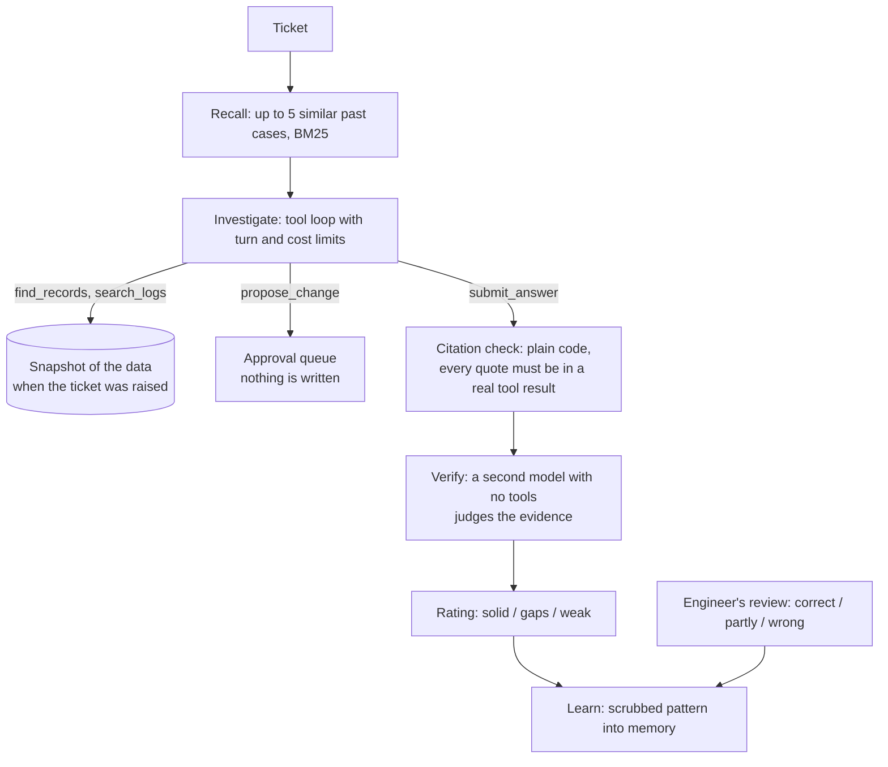

# grounded-agent

A support-investigation agent that has to prove what it says.

It reads a support ticket, investigates with read-only tools over the app's data and logs, and answers with a cause, a fix and a reply for the customer. Every claim has to quote the evidence it came from, plain code checks those quotes, a second model judges whether the evidence holds up, and any data fix is only *proposed* for a person to approve.

This is a small, from-scratch version of the patterns behind an agent I built and run in production at work, investigating escalated support tickets. It contains no code or data from that system: the app ("Acme"), its tickets and its data are made up.

## How a run works



## Design decisions

**Context: what the agent sees, and when.**
- The ticket, read-only tools, and up to five similar past cases in full. Everything else in memory stays out of the prompt.
- Past cases are labelled "hints, not answers", so the agent checks the data instead of pattern-matching to an old fix.
- Tool results are capped at 20,000 characters and tell the model to narrow its query, rather than flooding the context.
- Each tool result starts with its `call_id`, so the agent can cite exactly where a quote came from.

**Memory: what it remembers across sessions and users.**
- Memory stores problems, not customers: symptom, cause and fix. Emails, record ids, uuids and long numbers are scrubbed before anything is stored, which is what makes it safe to share across users.
- Weak evidence teaches nothing.
- There's no separate "confirm this pattern" step. An engineer's normal review of an answer (correct, partly or wrong) confirms or disputes the pattern behind it. A separate step is one nobody runs.
- Recall is BM25 for now. At this size keyword recall does the job, and embeddings would add infrastructure without a measured gain. Swap them in when the catalogue outgrows it.

**Orchestration: steps, loops and knowing when to stop.**
- The pipeline is fixed: recall, investigate, check, verify, rate. Only the investigate step is a free tool loop.
- The loop stops on `submit_answer`, a turn limit, a cost limit, a refusal, or a model that still won't submit after one nudge.
- All tool results from one turn go back in a single message.

**Trust: why an answer can be acted on.**
- Every claim needs a word-for-word quote and the id of the tool call it came from. `check_citations` is plain code, so a made-up quote can't get through, even if the verifying model is fooled (there's a test for exactly that).
- The verifier gets no tools and none of the investigator's working, so it judges the evidence with fresh eyes.
- Writes are proposals. The agent can only propose a change to a record it has actually read, one field at a time, and nothing touches the data.

**Model choice, cost and observability.**
- Each step (investigate, verify, judge) has its own model and effort level, set in `grounded_agent/router.py` or from the environment, e.g. `MODEL_VERIFY=claude-sonnet-5-5 EFFORT_VERIFY=low`.
- Every model call is traced: step, model, tokens, cost, time and tools called, written to `runs/<run id>/trace.jsonl`.
- Requests opt into server-side fallback, so a safety decline is retried on another model in the same call.

## Evals

Each golden case is a reviewed ticket with what really happened (the cause, whether it needed escalating, and the exact data fix) plus a **snapshot of the data as it was when the ticket was raised**.

Cases replay against the snapshot, not against a recording of the tool calls the original run made. That matters: a new model or prompt can take a different, cheaper route through the data and still be scored on the outcome.

Each run is scored on:
- **cause:** judged by a model as the same, partly the same, or different
- **escalation:** exact
- **data fix:** field by field. The right record, field and value, and nothing else. Expecting no fix means proposing none.
- **cost and turns**

A case passes when the cause is at least partly right and the escalation and fix are exact. `--k` runs each case several times and reports **pass^k**, the share of cases that passed on every run. That measures whether it's reliable, not just whether it can get there once.

## Run it

Needs Python 3.11+ and [uv](https://docs.astral.sh/uv/).

```bash
uv sync
uv run pytest                    # 17 tests, scripted model, no API key needed
```

With Anthropic credentials (`ANTHROPIC_API_KEY`, or `ant auth login`), these call the API and cost money:

```bash
uv run grounded-agent investigate T-1001          # investigate one golden ticket, learn from it, write a trace
uv run grounded-agent review P-1 T-1001 correct   # an engineer's review of that answer
uv run grounded-agent eval --k 3                  # every golden case, 3 runs each
```

## Layout

| File | What it does |
| --- | --- |
| `grounded_agent/agent.py` | The pipeline and the investigate loop |
| `grounded_agent/tools.py` | Tool definitions (strict schemas) and the tool runner |
| `grounded_agent/world.py` | Read-only sandbox over a snapshot, and the approval queue |
| `grounded_agent/citations.py` | The quote check |
| `grounded_agent/verify.py` | The second-model verifier and the rating |
| `grounded_agent/memory.py` | Scrubbing, BM25 recall, learning from runs and reviews |
| `grounded_agent/router.py` | Model and effort per step |
| `grounded_agent/trace.py` | Per-call tracing and cost |
| `grounded_agent/evals.py` | Golden-case replay, scoring and pass^k |
| `data/` | Made-up tickets, data snapshots and expected answers |

## What I'd add next

- A second provider behind `ModelClient` (e.g. OpenRouter), so routing can compare models across vendors on the same eval.
- Prompt caching on the system prompt and tool definitions, which stay fixed across turns.
- Embedding recall, once keyword recall measurably misses.
